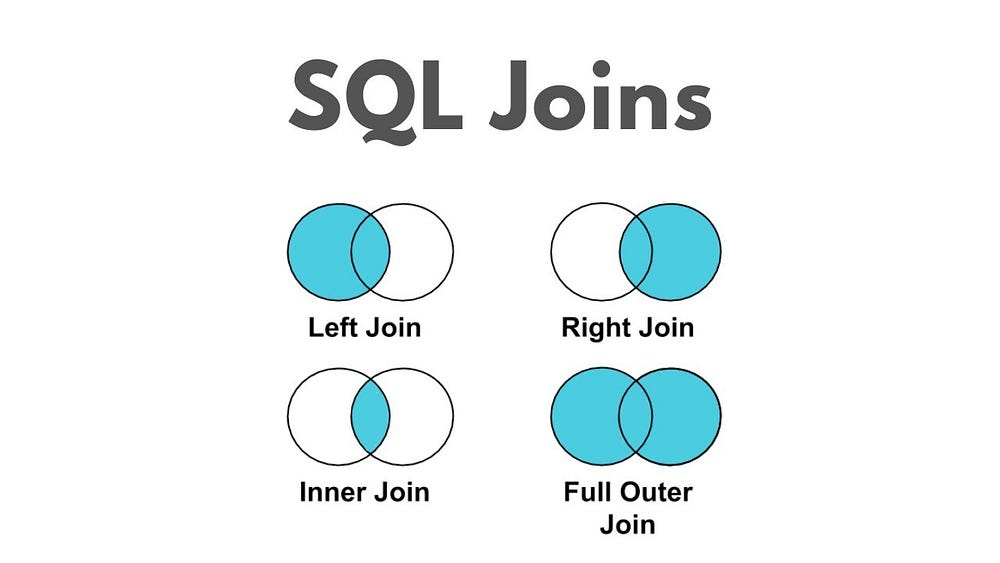
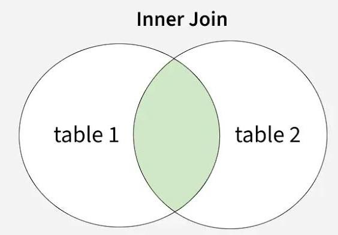
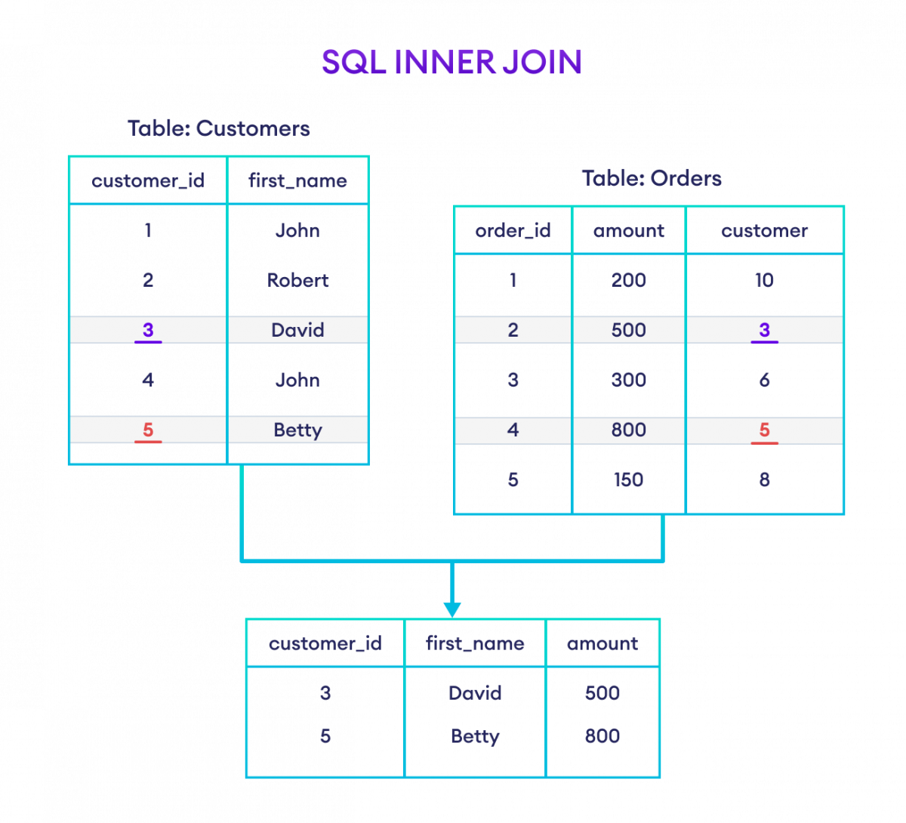
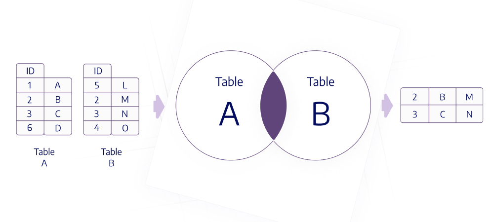
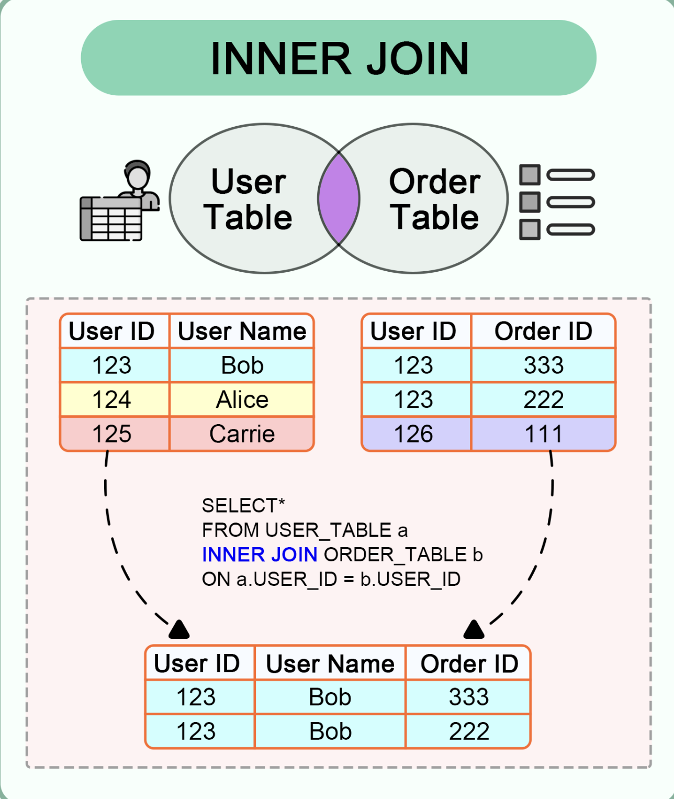
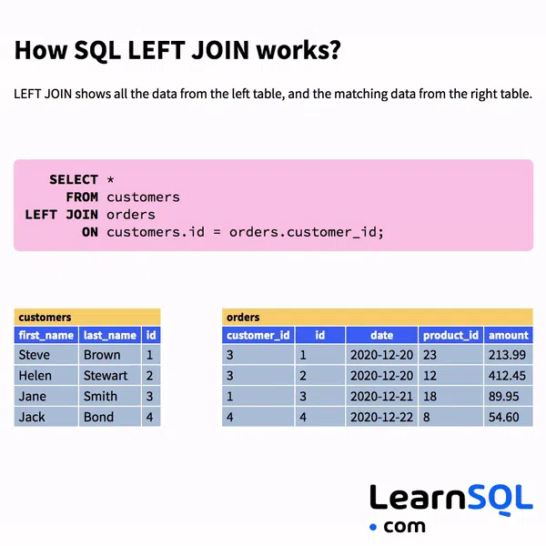
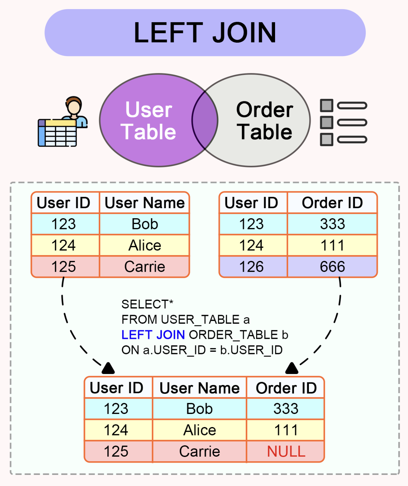
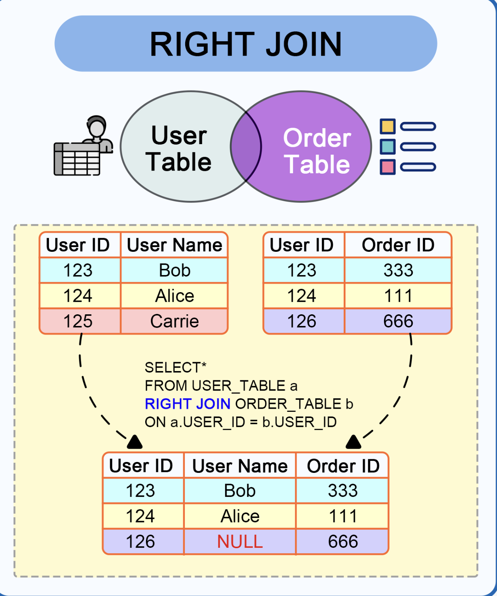
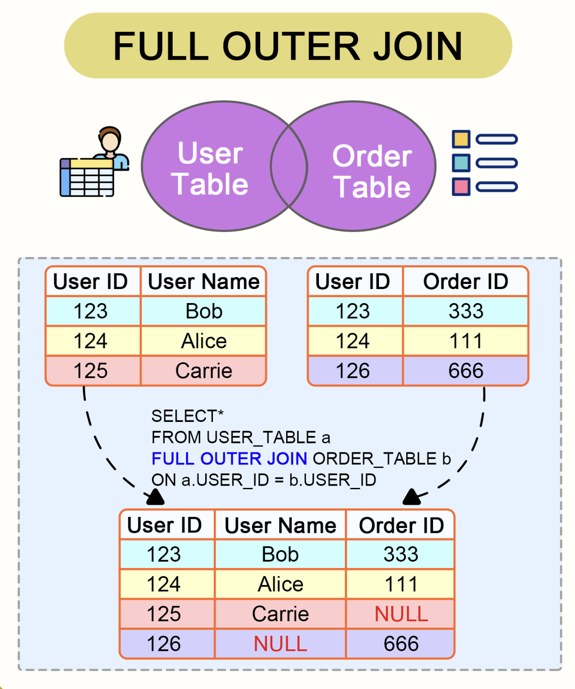

# Join Operation in Action
* Database: DuckDB version 1.5.5




## Table t1

```sql
CREATE TABLE t1 (
   id  INT,
   value1 VARCHAR
);

INSERT INTO t1(id, value1) VALUES
(1, 'v1'), 
(1, 'v2'), 
(2, 'v3'), 
(2, 'v4'), 
(3, 'v5'), 
(4, 'v6'), 
(5, 'v7');

SELECT id, value1 FROM t1;
┌───────┬─────────┐
│  id   │ value1  │
│ int32 │ varchar │
├───────┼─────────┤
│     1 │ v1      │
│     1 │ v2      │
│     2 │ v3      │
│     2 │ v4      │
│     3 │ v5      │
│     4 │ v6      │
│     5 │ v7      │
└───────┴─────────┘
7 rows in set 
```

-----

## Table t2

```sql
CREATE TABLE t2 (
   id  INT,
   value2 VARCHAR
);

INSERT INTO t2(id, value2)
VALUES
(1, 'w1'), 
(1, 'w2'), 
(2, 'w3'), 
(2, 'w4'), 
(2, 'w5'), 
(3, 'w6'), 
(6, 'w7'), 
(7, 'w8');

SELECT id, value2 FROM t2;
┌───────┬─────────┐
│  id   │ value2  │
│ int32 │ varchar │
├───────┼─────────┤
│     1 │ w1      │
│     1 │ w2      │
│     2 │ w3      │
│     2 │ w4      │
│     2 │ w5      │
│     3 │ w6      │
│     6 │ w7      │
│     7 │ w8      │
└───────┴─────────┘
8 rows in set 
```

------

## INNER-JOIN

	1. The purpose of an INNER JOIN is to 
	   combine rows from two or more tables 
	   and return only the rows where the 
	   join condition is met in both tables.
	
	2. The INNER JOIN keyword selects records 
	   that have matching values in both tables.
	
	









* `INNER JOIN` with `ON`

```sql
SELECT t1.id AS t1_id,
       t1.value1,
       t2.id AS t2_id,
       t2.value2
FROM t1
INNER JOIN t2 ON t1.id = t2.id
ORDER by t1.id;
┌───────┬─────────┬───────┬─────────┐
│ t1_id │ value1  │ t2_id │ value2  │
│ int32 │ varchar │ int32 │ varchar │
├───────┼─────────┼───────┼─────────┤
│     1 │ v2      │     1 │ w1      │
│     1 │ v2      │     1 │ w2      │
│     1 │ v1      │     1 │ w1      │
│     1 │ v1      │     1 │ w2      │
│     2 │ v4      │     2 │ w3      │
│     2 │ v4      │     2 │ w4      │
│     2 │ v4      │     2 │ w5      │
│     2 │ v3      │     2 │ w3      │
│     2 │ v3      │     2 │ w4      │
│     2 │ v3      │     2 │ w5      │
│     3 │ v5      │     3 │ w6      │
└───────┴─────────┴───────┴─────────┘
  11 rows                 4 columns
```

* `INNER JOIN` with `USING`

```sql
SELECT id,
       t1.value1,
       t2.value2
FROM t1
INNER JOIN t2 USING( id ) 
ORDER BY id;
┌───────┬─────────┬─────────┐
│  id   │ value1  │ value2  │
│ int32 │ varchar │ varchar │
├───────┼─────────┼─────────┤
│     1 │ v2      │ w1      │
│     1 │ v2      │ w2      │
│     1 │ v1      │ w1      │
│     1 │ v1      │ w2      │
│     2 │ v4      │ w3      │
│     2 │ v4      │ w4      │
│     2 │ v4      │ w5      │
│     2 │ v3      │ w3      │
│     2 │ v3      │ w4      │
│     2 │ v3      │ w5      │
│     3 │ v5      │ w6      │
└───────┴─────────┴─────────┘
  11 rows         3 columns
```

-----


## LEFT-JOIN

	1. The business purpose of a LEFT JOIN is 
	   to retrieve all records from a "left" 
	   table while also including matching 
	   records from a "right" table. 
	
	2. This is crucial for scenarios where you 
	   need to ensure no data is lost from the 
	   primary (left) table, such as 
	   
	   		* listing all customers with their 
	   		  orders (including customers who 
	   		  have placed no orders) 
	   		
	   		or 
	   
	       * showing all departments with their 
	         employees (including departments 
	         with no employees). 

-----
   
#### how left-join works?



-----



```
SELECT *
FROM t1
LEFT JOIN t2 USING(id) 
ORDER BY id;
┌───────┬─────────┬─────────┐
│  id   │ value1  │ value2  │
│ int32 │ varchar │ varchar │
├───────┼─────────┼─────────┤
│     1 │ v2      │ w1      │
│     1 │ v2      │ w2      │
│     1 │ v1      │ w1      │
│     1 │ v1      │ w2      │
│     2 │ v4      │ w3      │
│     2 │ v4      │ w4      │
│     2 │ v4      │ w5      │
│     2 │ v3      │ w3      │
│     2 │ v3      │ w4      │
│     2 │ v3      │ w5      │
│     3 │ v5      │ w6      │
│     4 │ v6      │ NULL    │
│     5 │ v7      │ NULL    │
└───────┴─────────┴─────────┘
  13 rows         3 columns
```

------

## RIGHT-JOIN




```sql
SELECT *
FROM t1
RIGHT JOIN t2 USING(id)
ORDER BY id;
┌───────┬─────────┬─────────┐
│  id   │ value1  │ value2  │
│ int32 │ varchar │ varchar │
├───────┼─────────┼─────────┤
│     1 │ v2      │ w1      │
│     1 │ v2      │ w2      │
│     1 │ v1      │ w1      │
│     1 │ v1      │ w2      │
│     2 │ v4      │ w3      │
│     2 │ v4      │ w4      │
│     2 │ v4      │ w5      │
│     2 │ v3      │ w3      │
│     2 │ v3      │ w4      │
│     2 │ v3      │ w5      │
│     3 │ v5      │ w6      │
│     6 │ NULL    │ w7      │
│     7 │ NULL    │ w8      │
└───────┴─────────┴─────────┘
  13 rows         3 columns

```

------

## FULL-JOIN

		Full Join (also called a full outer join) 
		in DuckDB returns all rows from both tables, 
		combining matched rows where the join condition 
		is true and placing NULL values in columns 
		where there is no match on either side.



```sql
SELECT 
    t1.id AS t1_id,
    t1.value1,
    t2.id AS t2_id,
    t2.value2
FROM t1
FULL JOIN t2 ON t1.id = t2.id
ORDER by t1.id;
┌───────┬─────────┬───────┬─────────┐
│ t1_id │ value1  │ t2_id │ value2  │
│ int32 │ varchar │ int32 │ varchar │
├───────┼─────────┼───────┼─────────┤
│     1 │ v2      │     1 │ w1      │
│     1 │ v2      │     1 │ w2      │
│     1 │ v1      │     1 │ w1      │
│     1 │ v1      │     1 │ w2      │
│     2 │ v4      │     2 │ w3      │
│     2 │ v4      │     2 │ w4      │
│     2 │ v4      │     2 │ w5      │
│     2 │ v3      │     2 │ w3      │
│     2 │ v3      │     2 │ w4      │
│     2 │ v3      │     2 │ w5      │
│     3 │ v5      │     3 │ w6      │
│     4 │ v6      │  NULL │ NULL    │
│     5 │ v7      │  NULL │ NULL    │
│  NULL │ NULL    │     6 │ w7      │
│  NULL │ NULL    │     7 │ w8      │
└───────┴─────────┴───────┴─────────┘
  15 rows                 4 columns

```
* `FULL JOIN` with `ON`

```
SELECT 
    id,
    t1.value1,
    t2.value2
FROM t1
FULL JOIN t2 USING( id )
ORDER by id;
┌───────┬─────────┬─────────┐
│  id   │ value1  │ value2  │
│ int32 │ varchar │ varchar │
├───────┼─────────┼─────────┤
│     1 │ v2      │ w1      │
│     1 │ v2      │ w2      │
│     1 │ v1      │ w1      │
│     1 │ v1      │ w2      │
│     2 │ v4      │ w3      │
│     2 │ v4      │ w4      │
│     2 │ v4      │ w5      │
│     2 │ v3      │ w3      │
│     2 │ v3      │ w4      │
│     2 │ v3      │ w5      │
│     3 │ v5      │ w6      │
│     4 │ v6      │ NULL    │
│     5 │ v7      │ NULL    │
│     6 │ NULL    │ w7      │
│     7 │ NULL    │ w8      │
└───────┴─────────┴─────────┘
  15 rows         3 columns
```

------

## Cross Join = Cartesian Product

```
-- t1.num_of_rows = 7
-- t2.num_of_rows = 8
-- CROSS-JOIN(t1, t2) = 7 * 8 rows = 56 rows
```


```sql
duckdb ▸ .maxrows 1000
duckdb ▸ SELECT *
         FROM t1, t2;
┌───────┬─────────┬───────┬─────────┐
│  id   │ value1  │  id   │ value2  │
│ int32 │ varchar │ int32 │ varchar │
├───────┼─────────┼───────┼─────────┤
│     1 │ v1      │     1 │ w1      │
│     1 │ v1      │     1 │ w2      │
│     1 │ v1      │     2 │ w3      │
│     1 │ v1      │     2 │ w4      │
│     1 │ v1      │     2 │ w5      │
│     1 │ v1      │     3 │ w6      │
│     1 │ v1      │     6 │ w7      │
│     1 │ v1      │     7 │ w8      │
│     1 │ v2      │     1 │ w1      │
│     1 │ v2      │     1 │ w2      │
│     1 │ v2      │     2 │ w3      │
│     1 │ v2      │     2 │ w4      │
│     1 │ v2      │     2 │ w5      │
│     1 │ v2      │     3 │ w6      │
│     1 │ v2      │     6 │ w7      │
│     1 │ v2      │     7 │ w8      │
│     2 │ v3      │     1 │ w1      │
│     2 │ v3      │     1 │ w2      │
│     2 │ v3      │     2 │ w3      │
│     2 │ v3      │     2 │ w4      │
│     2 │ v3      │     2 │ w5      │
│     2 │ v3      │     3 │ w6      │
│     2 │ v3      │     6 │ w7      │
│     2 │ v3      │     7 │ w8      │
│     2 │ v4      │     1 │ w1      │
│     2 │ v4      │     1 │ w2      │
│     2 │ v4      │     2 │ w3      │
│     2 │ v4      │     2 │ w4      │
│     2 │ v4      │     2 │ w5      │
│     2 │ v4      │     3 │ w6      │
│     2 │ v4      │     6 │ w7      │
│     2 │ v4      │     7 │ w8      │
│     3 │ v5      │     1 │ w1      │
│     3 │ v5      │     1 │ w2      │
│     3 │ v5      │     2 │ w3      │
│     3 │ v5      │     2 │ w4      │
│     3 │ v5      │     2 │ w5      │
│     3 │ v5      │     3 │ w6      │
│     3 │ v5      │     6 │ w7      │
│     3 │ v5      │     7 │ w8      │
│     4 │ v6      │     1 │ w1      │
│     4 │ v6      │     1 │ w2      │
│     4 │ v6      │     2 │ w3      │
│     4 │ v6      │     2 │ w4      │
│     4 │ v6      │     2 │ w5      │
│     4 │ v6      │     3 │ w6      │
│     4 │ v6      │     6 │ w7      │
│     4 │ v6      │     7 │ w8      │
│     5 │ v7      │     1 │ w1      │
│     5 │ v7      │     1 │ w2      │
│     5 │ v7      │     2 │ w3      │
│     5 │ v7      │     2 │ w4      │
│     5 │ v7      │     2 │ w5      │
│     5 │ v7      │     3 │ w6      │
│     5 │ v7      │     6 │ w7      │
│     5 │ v7      │     7 │ w8      │
└───────┴─────────┴───────┴─────────┘
  56 rows                 4 columns

```
