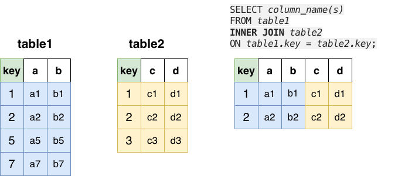
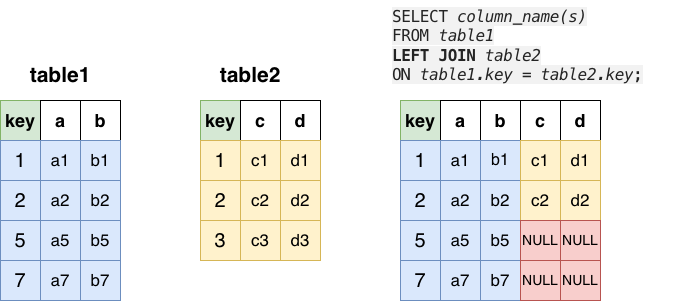
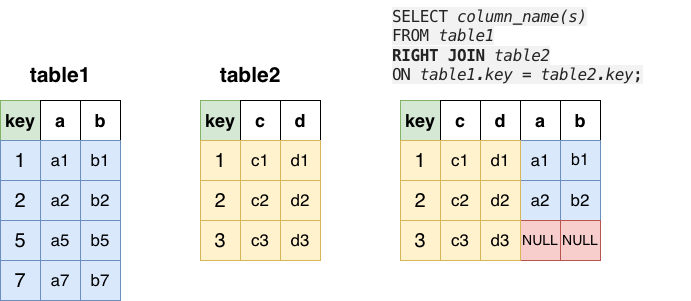

# OMIS 105: Week 6
## Joins II — Session 1 <br> LEFT, RIGHT, and Finding What Is Missing

---

# Agenda

- Recap: what a JOIN does
- Meet our data: **Valley Fitness**
- `INNER JOIN` vs. `LEFT JOIN` vs. `RIGHT JOIN` — side by side
- `RIGHT JOIN` is a `LEFT JOIN` turned around
- Finding what is missing: `LEFT JOIN ... WHERE ... IS NULL`
- `COALESCE`: a friendly value instead of `NULL`
- The `ON` vs. `WHERE` trap
- Hands-on practice

---

# Recap from Week 5

- A **JOIN** puts matching rows from two tables side by side
- The `ON` clause says **how** rows match: `ON a.key = b.key`
- `INNER JOIN` keeps **only matching rows**
- `LEFT JOIN` keeps **every row of the left table**

👉 This week: **lots of practice**, on a new dataset, with
real business questions

---

# Meet Valley Fitness 🏋️

A small gym with **4 tables**:

| Table | Rows | One row is… | Key columns |
|---|---|---|---|
| `members` | 10 | a gym member | `member_id` |
| `bookings` | 16 | one member booking one class | `member_id`, `class_id` |
| `classes` | 8 | a class (yoga, spin, …) | `class_id`, `trainer_id` |
| `trainers` | 6 | a trainer | `trainer_id`, `manager_id` |

```
members ──< bookings >── classes >── trainers
                                       │
                                       └── manager_id → trainers
```

---

# The Data Has Gaps — On Purpose

Real data is never perfect. These gaps make each JOIN give a
**different** answer:

| Gap | Where |
|---|---|
| 2 members **never booked** a class | Ava Martinez, Ben Taylor |
| 1 booking has an **unknown member** (12) | booking 1015 — account deleted |
| 1 class was **never booked** | Aqua Fitness |
| 1 class has **no trainer** yet | Senior Stretch |
| 2 trainers **teach no class** | Maria Lopez, Noah Kim |

👉 Keep this slide in mind. Every query today finds one of these.

---

# The `members` Table (10 rows)

| member_id | member_name | city |
|---|---|---|
| 1 | Olivia Brown | Santa Clara |
| 2 | Liam Garcia | San Jose |
| 3 | Sophia Nguyen | Santa Clara |
| 4 | Ethan Patel | Sunnyvale |
| 5 | Mia Johnson | San Jose |
| 6 | Lucas Rossi | Cupertino |
| **7** | **Ava Martinez** | Santa Clara |
| **8** | **Ben Taylor** | Sunnyvale |
| 9 | Chloe Davis | San Jose |
| 10 | Ryan Lee | Cupertino |

(Also: `join_date`.) Members **7** and **8** have no bookings.

---

# The `bookings` Table (16 rows)

| booking_id | member_id | class_id | | booking_id | member_id | class_id |
|---|---|---|---|---|---|---|
| 1001 | 1 | 101 | | 1009 | 6 | 106 |
| 1002 | 1 | 102 | | 1010 | 9 | 101 |
| 1003 | 2 | 103 | | 1011 | 9 | 107 |
| 1004 | 3 | 101 | | 1012 | 10 | 102 |
| 1005 | 3 | 104 | | 1013 | 1 | 103 |
| 1006 | 4 | 102 | | 1014 | 2 | 105 |
| 1007 | 5 | 105 | | **1015** | **12** | 104 |
| 1008 | 5 | 103 | | 1016 | 4 | 101 |

(Also: `booking_date`.) Member **12** does not exist in `members`.

---

# `INNER JOIN` — Only Matches



Rows with a partner on **both** sides. Everything else is dropped.

---

# `INNER JOIN` — Members and Their Bookings

```sql
SELECT m.member_name, b.booking_id, b.class_id
FROM members AS m
INNER JOIN bookings AS b
    ON m.member_id = b.member_id
ORDER BY b.booking_id;
```

**Result: 15 rows.** Who is missing?

- Ava and Ben (no bookings) — **gone**
- Booking 1015 (unknown member) — **gone**

👉 `INNER JOIN` hides the gaps. Sometimes that is what you want.
Often it is not.

---

# `LEFT JOIN` — Keep Every Left Row



Every row of the **left** table (the one after `FROM`).
No partner? The right-side columns become `NULL`.

---

# `LEFT JOIN` — Every Member

```sql
SELECT m.member_name, b.booking_id, b.class_id
FROM members AS m
LEFT JOIN bookings AS b
    ON m.member_id = b.member_id
ORDER BY m.member_id, b.booking_id;
```

---

# `LEFT JOIN` — Result (17 rows)

| member_name | booking_id | class_id |
|---|---|---|
| *15 matched rows* | … | … |
| Ava Martinez | NULL | NULL |
| Ben Taylor | NULL | NULL |

👉 15 matched rows **+** 2 members with no booking = **17**

Ava and Ben are back. Their booking columns are `NULL`.

---

# `RIGHT JOIN` — Keep Every Right Row



Every row of the **right** table (the one after `JOIN`).
No partner? The left-side columns become `NULL`.

---

# `RIGHT JOIN` — Every Booking

```sql
SELECT m.member_name, b.booking_id, b.class_id
FROM members AS m
RIGHT JOIN bookings AS b
    ON m.member_id = b.member_id
ORDER BY b.booking_id;
```

| member_name | booking_id | class_id |
|---|---|---|
| *15 matched rows* | … | … |
| NULL | 1015 | 104 |

👉 15 matched rows **+** 1 booking with no member = **16**

---

# `RIGHT JOIN` = `LEFT JOIN`, Turned Around

Swap the two tables and use `LEFT JOIN`. Same 16 rows:

```sql
SELECT m.member_name, b.booking_id, b.class_id
FROM bookings AS b
LEFT JOIN members AS m
    ON m.member_id = b.member_id
ORDER BY b.booking_id;
```

- `A RIGHT JOIN B` gives the same rows as `B LEFT JOIN A`
- Most analysts write **only `LEFT JOIN`**: "start from the table
  you want to keep, then `LEFT JOIN` the rest"
- You still need to **read** `RIGHT JOIN` — you will see it at work

---

# Scoreboard: Same Tables, Three Answers

| Join | Rows | Why |
|---|---|---|
| `members INNER JOIN bookings` | **15** | matches only |
| `members LEFT JOIN bookings` | **17** | 15 + Ava + Ben |
| `members RIGHT JOIN bookings` | **16** | 15 + booking 1015 |

👉 Before you trust a result, ask:
**"Which rows did my JOIN keep, and which did it drop?"**

---

# Pattern: Finding What Is Missing

A business favorite: **"Who has never…?"**

1. Start `FROM` the table you want to check (the left table)
2. `LEFT JOIN` the table where a partner *should* be
3. Keep only rows with **no partner**: `WHERE right_key IS NULL`

This is often called an **anti-join**: "rows in A with **no** match in B".

---

# Members Who Never Booked a Class

```sql
SELECT m.member_id, m.member_name, m.city
FROM members AS m
LEFT JOIN bookings AS b
    ON m.member_id = b.member_id
WHERE b.booking_id IS NULL
ORDER BY m.member_id;
```

| member_id | member_name | city |
|---|---|---|
| 7 | Ava Martinez | Santa Clara |
| 8 | Ben Taylor | Sunnyvale |

💡 Marketing wants this list: send them a free-class coupon!

---

# Bookings With an Unknown Member

Same pattern, the other direction:

```sql
SELECT b.booking_id, b.member_id, b.class_id
FROM bookings AS b
LEFT JOIN members AS m
    ON m.member_id = b.member_id
WHERE m.member_id IS NULL;
```

| booking_id | member_id | class_id |
|---|---|---|
| 1015 | 12 | 104 |

💡 This is a **data quality** check. A booking points to a member who
no longer exists. (In Week 8 you will see how a `FOREIGN KEY` stops this.)

---

# Classes Nobody Booked

```sql
SELECT c.class_id, c.class_name
FROM classes AS c
LEFT JOIN bookings AS b
    ON c.class_id = b.class_id
WHERE b.booking_id IS NULL;
```

| class_id | class_name |
|---|---|
| 108 | Aqua Fitness |

💡 The manager asks: "Should we cancel Aqua Fitness?"

---

# Which Column Do I Test With `IS NULL`?

Test a column of the **right** table that is **never `NULL`** in real
rows — usually its **key**:

```sql
WHERE b.booking_id IS NULL     -- ✅ every real booking has an id
```

- If a match exists, the key is filled in
- If there is no match, the key is `NULL`

⚠️ Remember: `= NULL` never works. Always write `IS NULL`.

---

# `COALESCE` — A Friendly Value Instead of `NULL`

`COALESCE(a, b)` returns `a`, or `b` when `a` is `NULL`.

```sql
SELECT c.class_name,
       COALESCE(t.trainer_name, '(not assigned)') AS trainer
FROM classes AS c
LEFT JOIN trainers AS t
    ON c.trainer_id = t.trainer_id
ORDER BY c.class_id;
```

---

# `COALESCE` — Result

| class_name | trainer |
|---|---|
| Morning Yoga | Aisha Khan |
| Spin Cycle | James Chen |
| HIIT Bootcamp | Diego Santos |
| Pilates Core | Emma Wilson |
| Strength Basics | James Chen |
| Boxing Fit | Diego Santos |
| Senior Stretch | (not assigned) |
| Aqua Fitness | Emma Wilson |

👉 Senior Stretch has no trainer yet. The report says so in plain words.

---

# The `ON` vs. `WHERE` Trap ⚠️

**Question:** "Show **every** member, with their bookings made on or
after September 10."

```sql
SELECT m.member_name, b.booking_id, b.booking_date
FROM members AS m
LEFT JOIN bookings AS b
    ON m.member_id = b.member_id
WHERE b.booking_date >= DATE '2026-09-10'
ORDER BY m.member_id;
```

Only **5 rows**. Five members disappeared! 😱

---

# Why Did Members Disappear?

1. The `LEFT JOIN` keeps all 10 members ✅
2. Then `WHERE` runs on the joined rows
3. For Ava and Ben, `booking_date` is `NULL`
4. `NULL >= '2026-09-10'` is **not true**, so the row is removed ❌
5. Members whose bookings are all *before* Sept 10 are removed too ❌

👉 A `WHERE` filter on the **right** table quietly turns a
`LEFT JOIN` back into an `INNER JOIN`.

---

# The Fix: Put the Filter in `ON`

```sql
SELECT m.member_name, b.booking_id, b.booking_date
FROM members AS m
LEFT JOIN bookings AS b
    ON m.member_id = b.member_id
   AND b.booking_date >= DATE '2026-09-10'
ORDER BY m.member_id;
```

**10 rows** — every member is kept. Members with no
late booking show `NULL`.

---

# The Fix — Result

| member_name | booking_id | booking_date |
|---|---|---|
| Olivia Brown | 1013 | 2026-09-12 |
| Liam Garcia | 1014 | 2026-09-12 |
| Sophia Nguyen | NULL | NULL |
| Ethan Patel | 1016 | 2026-09-15 |
| Mia Johnson | NULL | NULL |
| Lucas Rossi | NULL | NULL |
| Ava Martinez | NULL | NULL |
| Ben Taylor | NULL | NULL |
| Chloe Davis | 1011 | 2026-09-10 |
| Ryan Lee | 1012 | 2026-09-11 |

---

# Rule of Thumb

| You want to filter… | Put the condition in… |
|---|---|
| the **left** table (the one you keep) | `WHERE` |
| the **right** table (the optional one) | `ON ... AND ...` |
| to find rows with **no** match | `WHERE right_key IS NULL` |

---

# Three Common Mistakes

**1. Ambiguous column name** — both tables have `member_id`:

```sql
SELECT member_id FROM members m JOIN bookings b ON m.member_id = b.member_id;
-- Binder Error: Ambiguous reference to column name "member_id"
--   (use: "m.member_id" or "b.member_id")
```

Fix: write `m.member_id` or `b.member_id`.

**2. Writing `= NULL`** — always returns no rows. Use `IS NULL`.

**3. `COUNT(*)` after a `LEFT JOIN`** — counts the `NULL` rows too.
We fix this in Session 2.

---

# Summary

- `INNER JOIN` → matches only (15 rows)
- `LEFT JOIN` → all left rows (17 rows)
- `RIGHT JOIN` → all right rows (16 rows)
- `A RIGHT JOIN B` = `B LEFT JOIN A`
- Anti-join: `LEFT JOIN ... WHERE right_key IS NULL`
- `COALESCE` turns `NULL` into a friendly value
- Filter the optional (right) table in `ON`, not in `WHERE`

---

# Next Session

**Joins at Work**

- Counting with `LEFT JOIN` + `GROUP BY` (including zero!)
- Joining 3 and 4 tables
- Self-joins: a table joined to itself
- A quick look at `FULL OUTER JOIN`

---

# Questions?

Thank you!

*OMIS 105 — Introduction to Database Management Systems — Fall 2026*
